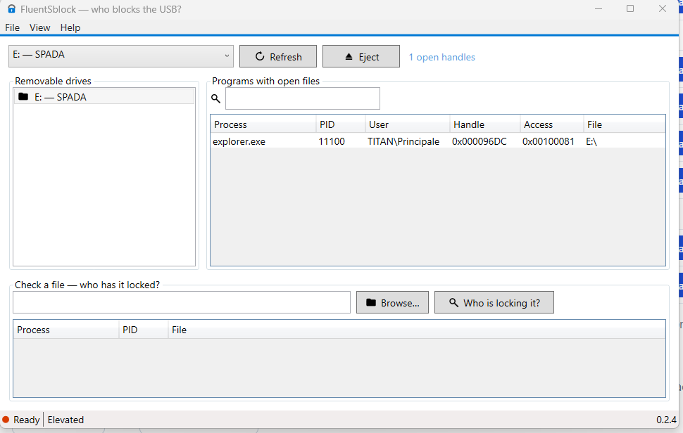

# FluentSblock — who holds files open?

Shows which programs hold open files on removable drives and block safe
ejection — and who is holding a given file locked.



## Features

- **Removable drives**: lists processes with open files per volume (process, PID, user, handle, access mask, path), including USB-Fixed SSDs in enclosures.
- **Safe eject** via `CM_Request_Device_EjectW`, with confirmation when holders exist and localized veto/error messages.
- **Check a file**: paste a path (or drag & drop a file/folder, Browse, or the Paste button for copied files/paths) to find who holds it — UNC paths and mapped drives included.
- **Holders filter**, copy-path / open-location row menu, CSV/TSV export.
- Read-only by design: no handle closing, no kernel driver, no network.
- UI: C# .NET 8 WPF, manual Fluent 2 styling, Mica backdrop, system accent,
  inline vector icons, theme/language persistence, autostart option.
- Languages: English, French, Italian, German, Spanish (full EFIGS).

## Download

Get the latest release from the
[releases page](https://github.com/ciskje/FluentSblock/releases/latest):

| File | What |
|---|---|
| `FluentSblock-Setup-X.Y.Z.exe` | Machine installer into Program Files (needs admin): Start Menu entry, Settings uninstall, no .NET needed |
| `FluentSblock.msix` | Signed MSIX package (clean identity). First install the cert: double-click `installer/FluentSblock.cer` → Local Machine (admin) → Trusted People, then open the `.msix` |
| `FluentSblock.exe` | Single self-contained app (no install, no .NET needed) |

Unsigned builds: on first run SmartScreen shows a blue screen → "More info" → "Run anyway".

> Tip: the app elevates at launch (UAC) to see all users' processes. To check a
> file, drag & drop it as standard user — or, elevated included, use the Paste
> button with a copied file/path, Browse, or Ctrl+V. The Admin/User button
> restarts as standard user and back.

> Note: there is no `dist/` folder in git (build outputs are gitignored) —
> every file above comes from the release assets.

## How it works

Windows has no `/proc`: the app snapshots every open handle with the native
`NtQuerySystemInformation(SystemExtendedHandleInformation)`, duplicates each
handle into its own process, resolves type and NT path with `NtQueryObject`,
converts `\Device\...` to drive letters, and maps PIDs to exe names and owners
(`SeDebugPrivilege` when available). Single files fall back to Restart Manager
first. See [`AGENT.md`](AGENT.md) (agent spec) and [`TODO.md`](TODO.md) (roadmap).

## Build from source

Requirements: .NET 8 SDK (`8.0.425`), Windows 10 1809+ / 11 x64.

```bat
dotnet build src\FluentSblock\FluentSblock.csproj --artifacts-path C:/Temp/opencode/FluentSblock-artifacts -c Debug
dotnet test src\FluentSblock.Tests\FluentSblock.Tests.csproj -c Debug
```

`run-debug.bat` launches the Debug build (asks UAC when not elevated).
`installer\build-setup.bat` rebuilds the Inno Setup installer (needs Inno Setup 6/7).

## License

[MIT](LICENSE.txt) © 2026 Francesco Ferrara.
